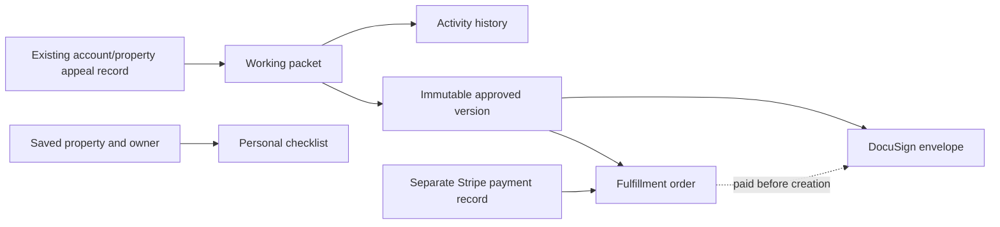

# Appeal workflow schema and migration record

Applied to remote Cloudflare D1 `appeal_db` (`ccbba211-1c8b-46b6-94f5-12e1cf840609`) on **November 3, 2026, 10:56 AM America/Chicago**. The user explicitly lifted the previous migration hold after requesting a schema review.

Only migrations **0029, 0030 and 0031** were applied. Migration 0028 (property sales) remained pending and was excluded using a temporary migration directory containing only these three files. No application deployment, payment activation, R2 provisioning or DocuSign credential setup was performed.

## Model

| Table | Purpose and integrity rules |
|---|---|
| `appeals` (existing) | Account/property records and Stripe payment state. Free cases use `free_` IDs and zero amount; fulfillment checkout has its own Stripe session row. Existing rows were not rebuilt. |
| `appeal_packets` | Mutable case state, document metadata/private R2 keys, optimistic revision and latest event ID. Requires an existing appeal record and valid JSON. |
| `appeal_packet_events` | Actor, action, resulting stage and timestamp. Indexed by case and creation time. |
| `packet_versions` | Immutable owner-approved snapshot for each packet/version. Automatically captured when the working state enters approved. Approving user must own the parent case. |
| `self_appeal_cases` | Personal checklist by account, saved address, agency and year. Composite foreign key ensures that the address belongs to that account and prevents deletion while referenced. Board research remains supported here; fulfillment is Assessor-only. |
| `packet_fulfillment_orders` | Separate checkout attempts linked to the approved version and customer. USD 4900 cents, service and terms version recorded. Requires an existing Stripe order with matching account/amount and an Assessor snapshot. Linkage cannot be reassigned. |
| `packet_signatures` | One signing record per packet/version; environment, envelope identity, operation lock, polling timestamp and provider status. Requires paid fulfillment before insertion. Envelope identity cannot be reassigned; demo and production are distinct. |

Customer IDs refer to Firebase identities; no local user/password table was added. PDFs and photographs remain in private R2. SQL stores references and metadata, not file contents or DocuSign credentials.

## Why this shape

- Preparation remains independent of payment; a free workspace can exist without a Stripe session or envelope.
- Payment and DocuSign reference an approved snapshot, so a corrected packet cannot silently inherit an earlier signature or purchase.
- Multiple checkout attempts may refer to the same version; payment status remains in the existing Stripe-backed record rather than being duplicated into a second status field.
- The database adds a second payment-before-signing check in addition to API checks. The API also rechecks payment before sending and dispatch.
- Mailing, carrier delivery and county confirmation are distinct workflow states and events. Their evidence references remain in the packet JSON. They are not inferred from payment or signature completion.
- This is an additive migration. Existing property-data tables and payment/customer rows are preserved. No broad historical migration replay was performed.

## Validation and result

Before migration: 35 JavaScript tests and six real SQLite schema tests passed. The SQLite tests cover immutable snapshots, owner checks, approved-version requirements, payment-before-signing, envelope identity, saved-address ownership, JSON validity, preserved rows and foreign-key consistency.

After migration: the D1 ledger reports all three applied at 16:56:18–19 UTC on November 3, 2026. All six new tables and eight triggers were verified. Foreign-key checks on every new table returned no violations. Existing counts remained **8 appeals and 30 saved addresses**. No customer test fixtures were inserted into production.

Pre-migration Time Travel bookmark:
`00000373-00000000-00005118-d3067ea0c1c824089cc5a3b6460cce04`

Time Travel recovery is database-wide and can affect later writes. Do not restore automatically; assess intervening activity first. The bookmark has Cloudflare's retention limit. These migration files are now applied and must not be edited in place; future changes need a new numbered migration.

Applied file SHA-256 values:

- 0029: `6779f1b362312eb754dba454c9b0de88b8c0c70adbe56203d7956f1600f5329c`
- 0030: `5c13a5b002b861375fb1771b92c06f5c6df0c68ce2549bfe478b7d170f7cb3a0`
- 0031: `2ef0a2fedd004f004359d51bfaee5d2f09a37cea531aa16872038e1b42899776`

## Remaining service setup

Application deployment, private R2 provisioning, DocuSign demo credentials/consent and a real sandbox signing exercise remain outstanding. DocuSign acceptance by the Assessor is still a design assumption, not an outcome of this migration. This migration does not activate checkout or send documents.

Current limitations remain: one signer, no integrated notarization, no automatic transfer of payment to a revised version, and no automatic county filing. See [DOCUSIGN_INTEGRATION.md](DOCUSIGN_INTEGRATION.md).
